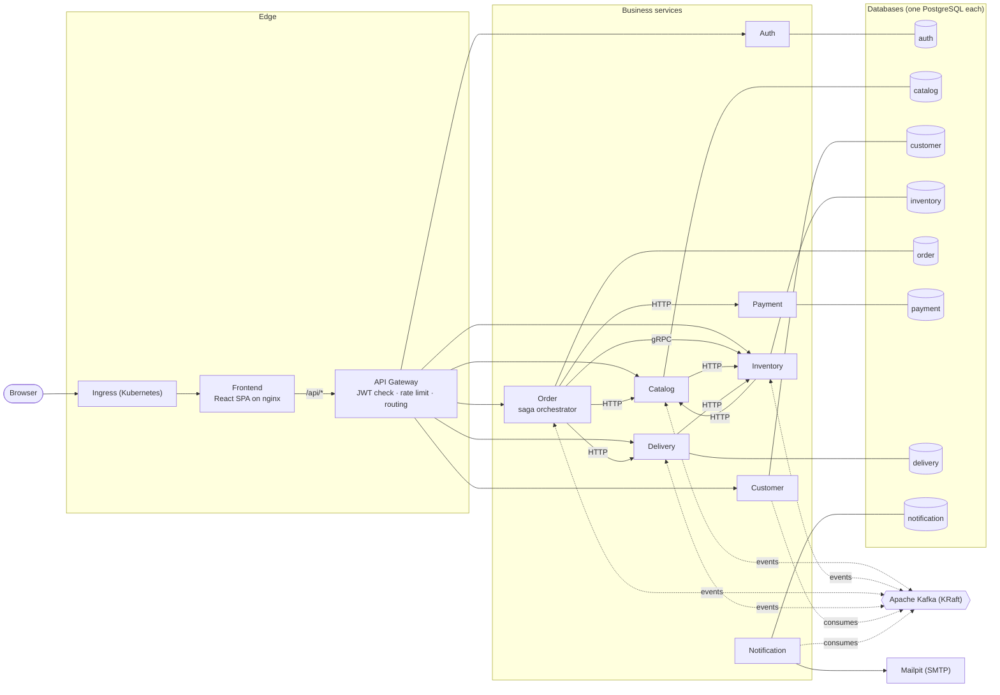
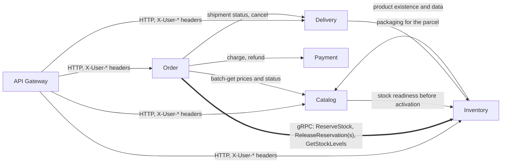
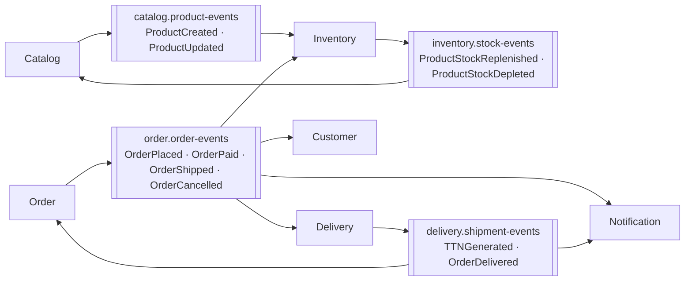
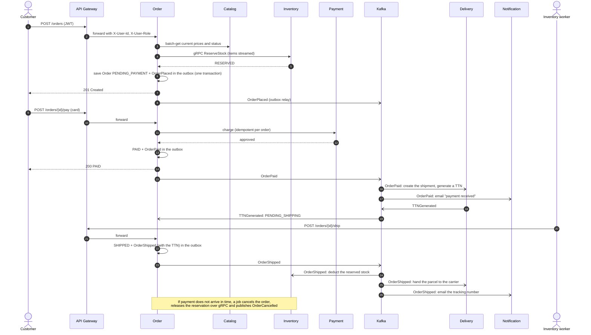
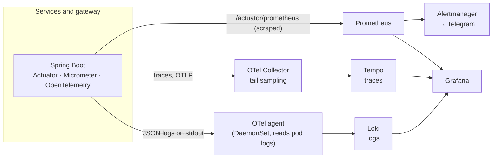

# VoltStore — System Architecture

The whole system on one page: services and their databases, how they talk to each other, the main business flow, and how the system is observed. The details are in the [service specs](services-specs/) and the [cross-service contracts](services-requirements/).

---

## 1. System Overview

Eight Spring Boot services behind one API Gateway, each with its own PostgreSQL database. Synchronous calls go over HTTP (and gRPC to Inventory); everything that can happen later goes through Kafka.

| Service | Owns | Port (cluster) | Role |
|---|---|---|---|
| API Gateway | — (no database) | 8080 | Single entry point: verifies JWTs, rate limits per client IP, forwards the caller as trusted headers, routes to the services |
| Auth | users, password hashes | 8086 | Registration, login, JWT issuance, staff accounts |
| Catalog | categories, products | 8081 | Product catalog, activation (asks Inventory whether stock is ready) |
| Customer | profiles, carts | 8087 | Customer profile and server-side cart |
| Inventory | stock items, reservations, packaging | 8084, gRPC 9090 | Stock levels, all-or-nothing reservations, packaging data |
| Order | orders, outbox, idempotency keys | 8082 | Checkout and order lifecycle; orchestrates the sagas |
| Payment | payment transactions | 8085 | Card charges and refunds through a mocked payment gateway (internal only) |
| Delivery | shipments | 8083 | Shipments and tracking numbers (TTN) through a mocked carrier |
| Notification | sent notifications | — (no public API) | Customer emails triggered by order and delivery events |

Payment and Notification are not routed by the gateway: Payment is called only by Order, and Notification only listens to Kafka.

---

## 2. Synchronous Communication

Declarative HTTP clients (`@HttpExchange` interfaces on `RestClient`) and one gRPC client. Order's clients are protected by Resilience4j (retry, circuit breaker, bulkhead, with fallbacks); the other services' clients use timeouts and turn an outage into a `503` or a later retry. Service-to-service calls carry a shared internal token (`X-Internal-Token`); user calls carry the identity headers the gateway sets.

| Caller → callee | Protocol | Protection | Why synchronous |
|---|---|---|---|
| Order → Catalog | HTTP | retry, circuit breaker, bulkhead | Prices must be current at checkout |
| Order → Inventory | gRPC (all four call types) | circuit breaker, channel retries | The reservation decides whether the order exists |
| Order → Payment | HTTP | circuit breaker; Payment repeats uncertain calls itself | The customer waits for the payment result |
| Order → Delivery | HTTP | retry, circuit breaker | Dispatch needs the tracking number |
| Catalog → Inventory | HTTP | timeout; `503` to the manager | Activation needs packaging and stock |
| Inventory → Catalog | HTTP | timeout, one retry | A stock item may exist only for a known product |
| Delivery → Inventory | HTTP | timeout; the TTN job tries again later | Parcel size and weight for the carrier |

---

## 3. Asynchronous Communication (Kafka)

Every producer writes its events to an **outbox table in the same transaction** as the state change; a relay publishes them to Kafka. Consumers are **idempotent** (processed event ids are stored) and use retry topics with a dead-letter topic where ordering allows.

| Topic | Producer | Consumers | What the consumers do |
|---|---|---|---|
| `catalog.product-events` | Catalog | Inventory | Keeps product titles and status for stock items |
| `inventory.stock-events` | Inventory | Catalog | Shows "in stock" / "out of stock" on products (dead-letter topic `catalog.stock-events-dlt`) |
| `order.order-events` | Order | Customer, Inventory, Delivery, Notification | Customer clears the cart (`OrderPaid`); Delivery creates the shipment (`OrderPaid`) and hands it to the carrier (`OrderShipped`); Inventory deducts the reserved stock (`OrderShipped`); Notification emails the customer about every step |
| `delivery.shipment-events` | Delivery | Order, Notification | Order moves to `PENDING_SHIPPING` (`TTNGenerated`) and `DELIVERED` (`OrderDelivered`); Notification emails the delivery |

The event payloads are in the [events catalogue](services-requirements/events-catalogue.md).

---

## 4. Main Business Flow: Checkout, Payment, Delivery

Order orchestrates the checkout saga. Each step is a local transaction; a failure is compensated (release the reservation, refund the payment), and scheduled jobs finish what an outage interrupted (expired payment windows, interrupted cancellations, orphan reservations, owed refunds).

The order states are in the [order state machine](entities/order-state-machine.md).

---

## 5. Observability

Every service exposes metrics, writes JSON logs with the trace id, and sends traces over OTLP. Grafana shows all three, linked by `traceId`.

- **Metrics:** Micrometer with the Prometheus registry; business metrics such as outbox backlog, payments, notifications, TTN generation and gateway rate-limit rejections.
- **Logs:** ECS JSON on the console, one object per line, with `traceId` and `spanId` from the tracing context.
- **Traces:** W3C trace context across HTTP, gRPC and Kafka; one request can be followed from the gateway through Order, Inventory and Kafka consumers. The collector keeps every trace with an error.

---

## 6. Deployment

The same images run on Docker Compose (local development) and Kubernetes (minikube).

- **Kubernetes:** namespace `voltstore`; one Deployment and Service per service and per database (PersistentVolumeClaim); Kafka as a StatefulSet; configuration in ConfigMaps, credentials in Secrets.
- **Network isolation:** NetworkPolicies deny all incoming traffic by default and allow only the listed paths (Ingress → frontend → gateway → services, the services' own databases, Kafka, observability).
- **Health:** liveness and readiness probes on Actuator's separate management port (8090), which is never routed.
- **Images:** multi-stage Dockerfiles (Maven build on Java 25, then a distroless Java 25 runtime) running as a non-root user with a read-only root file system; tag `1.0.0`.

---

## 7. Technology Stack

| Concern | Technology |
|---|---|
| Language and framework | Java 25, Spring Boot 4.1, Lombok |
| Persistence | Spring Data JPA, PostgreSQL (one database per service), Flyway |
| Edge and security | Spring Cloud Gateway (server WebMVC), JWT HS256 (Nimbus JOSE), internal token between services |
| Synchronous calls | `@HttpExchange` interfaces on `RestClient`, gRPC with Protocol Buffers |
| Resilience | Resilience4j: retry, circuit breaker, bulkhead, rate limiter (gateway) |
| Messaging | Apache Kafka (KRaft), Spring for Apache Kafka, transactional outbox, idempotent consumers, retry and dead-letter topics |
| Distributed transactions | Orchestrated sagas in Order, scheduled recovery jobs |
| Errors and DTOs | RFC 9457 ProblemDetail, DTOs as Java records |
| Observability | Actuator, Micrometer, Prometheus, Alertmanager, OpenTelemetry Collector, Tempo, Loki, Grafana |
| Testing | JUnit 5, Testcontainers (PostgreSQL, Kafka, Toxiproxy), WireMock, Pact contract tests, k6 load tests |
| Deployment | Docker Compose, Kubernetes (minikube), NetworkPolicies, Ingress |
| Frontend | React, TypeScript, Vite, Mantine |

---

## 8. Key Decisions

- **Database per service.** No service reads another's tables; data another service needs arrives through its API or its events (for example Inventory keeps product titles from `catalog.product-events`).
- **Orchestration, not choreography, for checkout.** Order drives the steps and their compensations in one place, which makes the flow and its failure handling readable in one service ([Order spec](services-specs/order-service-spec.md)).
- **Synchronous only where the caller must wait.** Prices, the reservation and the payment decide the answer to the customer; everything after payment (shipment, emails, stock events) is asynchronous.
- **gRPC for Inventory.** The reservation is the most frequent and latency-sensitive internal call; it uses all four gRPC call types ([gRPC report](../reports/grpc.md)).
- **Transactional outbox** instead of publishing directly: an event is sent if and only if its state change was committed.
- **Trust boundary at the gateway.** Only the gateway reads JWTs; services trust `X-User-*` headers only from inside the cluster, which NetworkPolicies enforce ([security model](services-requirements/security-model.md)).
