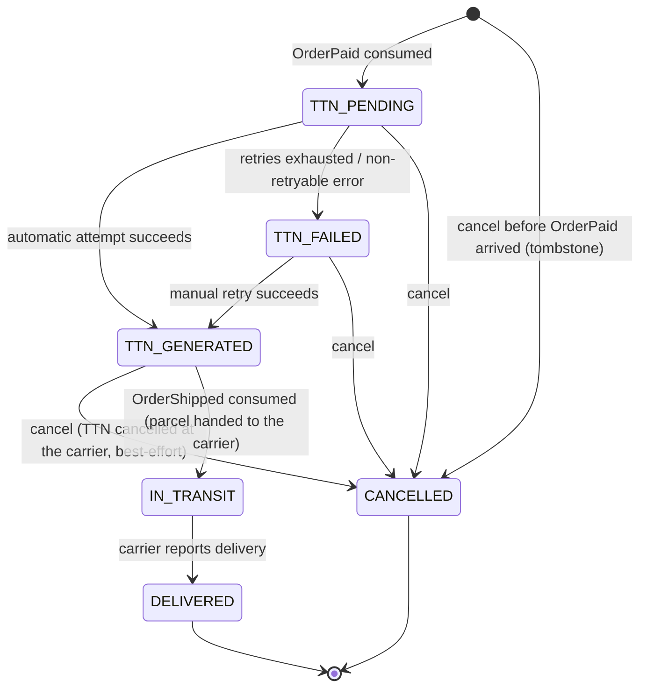

# Delivery Service — Implementation Spec

An Anti-Corruption Layer (ACL) for external postal carrier integration. It is the **sole service** that knows about carrier protocols, TTN formats, and carrier callbacks. No other service stores or processes carrier-specific data.

It owns `Shipment` — the internal representation of a parcel registration with the carrier. TTN generation is triggered automatically when payment is confirmed, with a three-tier resilience mechanism for carrier failures.

VoltStore has no real carrier. The carrier is simulated **in-process** by a `MockCarrierGateway` behind two ports: `CarrierGateway` (Delivery → carrier) and `CarrierEventHandler` (carrier → Delivery). See *Carrier Gateway*. A real carrier integration (e.g., Nova Poshta API) or an out-of-process simulator only replaces the port adapters; nothing outside the `carrier` package changes.

> **Revision note (design review, 2026-10-15, before implementation).** This version records the decisions taken before the Delivery backlog was written: a fat `OrderPaid` event, the `CANCELLED` status, the `TTNGenerated` event, the stacking heuristic for parcel dimensions, the in-process mock carrier, and a simulated delivery: Delivery consumes `OrderShipped`, hands the parcel to the mock, and the mock reports the delivery after a configurable delay (no webhook). Differences from the first version are listed under *Changes from the First Spec Version*. Tasks: [`docs/tasks/delivery-service/`](../../tasks/delivery-service/). Updated after implementation (tasks 01–16, 2026-10-15): details the code settled are marked "implementation" in the changes table.

---

## Service Overview

| | |
|---|---|
| **Owned entities** | `Shipment` (`id`, `orderId`, `status`, `ttn`, `failureReason`, `recipientName`, `recipientPhone`, `recipientAddress`, `carrier`, `items`, `totalWeightGrams`, `lengthCm`, `widthCm`, `heightCm`, `declaredValue`, `currency`, `handedOverAt`, `createdAt`, `updatedAt`); `ShipmentItem` (`productId`, `quantity`), a value collection of `Shipment` |
| **Key enums** | `ShipmentStatus { TTN_PENDING, TTN_FAILED, TTN_GENERATED, IN_TRANSIT, DELIVERED, CANCELLED }` (`DELIVERED` and `CANCELLED` are terminal) |
| **Events emitted** | `TTNGenerated`, `OrderDelivered` on topic `delivery.shipment-events` (see *Shipment Events*) |
| **Events consumed** | `OrderPaid`, `OrderShipped` (from Order Service, one topic; see *Consuming Order events*) |
| **Synchronous dependencies** | Inventory Service `GET /inventory/stock/{productId}/packaging` (EP-INV-05); the carrier, through `CarrierGateway` (in-process mock) |
| **Callers** | Order Service (internal), Inventory Worker (via API Gateway), the carrier (in-process, through `CarrierEventHandler`) |
| **Technical columns / tables** (not part of the domain model) | `attempts` (failed attempts, automatic and manual), `next_attempt_at` (null once the shipment left `TTN_PENDING`), `version` on `shipments`; `outbox_events` (transactional outbox for shipment events) |

---

## Cross-cutting Conventions

### Security and routing

Authentication follows the [Security Model](../services-requirements/security-model.md): the API Gateway validates the JWT and forwards `X-User-Id` / `X-User-Role`; internal callers send the shared `X-Internal-Token` and get role `SERVICE`. Every route has an explicit rule; anything else is denied (`denyAll`). The role check runs before the request body is parsed.

| Route | Role | Routed by the gateway |
|---|---|---|
| `GET /delivery/shipments` | `SERVICE` | no (internal) |
| `DELETE /delivery/shipments/{orderId}` | `SERVICE` | no (internal) |
| `POST /delivery/orders/{orderId}/ttn/retry` | `INVENTORY_WORKER` | yes |

`/actuator/health/**` is open for the probes. Outgoing calls to Inventory carry `X-Internal-Token` and `X-Correlation-Id`; user headers are never forwarded.

**No public endpoint and no webhook** (decision 2026-10-15). The carrier runs in-process, so it reports deliveries through a Java interface (`CarrierEventHandler`), not over HTTP. A webhook only makes sense when the carrier is a real external system; it returns, with an HMAC signature, together with the out-of-process simulator (see *Future: Out-of-Process Carrier Simulator*).

### Responses and errors

- Errors use the shared RFC 9457 `ProblemDetail` shape (`type`, `title`, `status`, `detail`, `timestamp`, `service`) with `type` = `https://voltstore.com/errors/{validation | not-found | conflict | ttn-generation-failed | unauthorized | forbidden | internal-error}`.
- `400` = malformed request (invalid JSON, a broken field rule, a non-UUID path or query value), always with an `errors` property (`{field: [messages]}`; `body` for invalid JSON). `409` = a well-formed request that the shipment's current state does not allow. Unexpected errors → `500` with a generic message.
- A successful call with nothing to return answers `204 No Content` (cancel).
- **OpenAPI:** the API is also described by an OpenAPI document generated from the code, `delivery-service/openapi/public.json` and `internal.json` ([OpenAPI Conventions](../services-requirements/openapi-conventions.md)); its error responses reference the named problem schemas listed there.

| Error | Status | Extra property |
|---|---|---|
| Shipment not found (EP-DEL-03) | `404` | — |
| Retry of a shipment not in `TTN_FAILED` (EP-DEL-03) | `409` | — |
| Cancel of an `IN_TRANSIT` or `DELIVERED` shipment (EP-DEL-02) | `409` | — |
| Manual TTN generation failed (EP-DEL-03) | `424` (type `ttn-generation-failed`) | `reason` |
| Empty, too long or malformed `orderIds` (EP-DEL-01) | `400` | `errors` |

### Shipment lifecycle



- **One shipment per order:** `orderId` is unique. A shipment is never deleted, so a terminal row also acts as an idempotency guard.
- **Tombstone:** cancelling an order whose `OrderPaid` has not been consumed yet creates a `CANCELLED` shipment without recipient data. A late `OrderPaid` then finds it and does nothing, so no TTN is registered for a cancelled order. Recipient, carrier and declared-value columns are therefore nullable at database level.
- **`IN_TRANSIT`** means the worker handed the parcel to the courier (`OrderShipped`); `handedOverAt` records when. From here the shipment cannot be cancelled, and only the carrier's delivery report moves it on.
- **Optimistic locking** (`version`) protects state changes that follow a carrier call made outside a transaction (see *Automatic TTN generation*).

### Automatic TTN generation (Tier 1 and Tier 2)

The `OrderPaid` consumer only **creates** the shipment (`TTN_PENDING`, `attempts = 0`, `next_attempt_at = now`). A scheduled **TTN generation job** in Delivery Service does the carrier work:

1. Claim due shipments: `status = TTN_PENDING` and `next_attempt_at <= now`, oldest first, up to a batch size (default 20), with `FOR UPDATE SKIP LOCKED`. The claim moves `next_attempt_at` forward by a lease (default 2 min), so another replica does not pick the same row while the attempt runs. The lease is a plain SQL update that does not increase `version`, so the version read at the claim still means "unchanged" when the result is applied. The claim transaction commits before any remote call.
2. For each claimed shipment, outside any transaction: fetch packaging for each distinct product from Inventory (EP-INV-05), compute the parcel (see *Parcel calculation*), and call `CarrierGateway.register(...)`.
3. Apply the result in a new transaction, only if the shipment is still `TTN_PENDING` with the version read at the claim (optimistic lock):
   - **Success** → `TTN_GENERATED`, store `ttn` and the parcel values, clear `failureReason`, append `TTNGenerated` to the outbox.
   - **Retryable failure** (carrier error or timeout → `carrier_error: <message>`; Inventory unavailable, timeout, `5xx` or an unexpected status such as `401`/`403` → `inventory_unavailable`, the last one logged at `ERROR` as a configuration problem) → `attempts + 1`, `failureReason` = the latest error, `next_attempt_at` = now + the next back-off. After the last retry → `TTN_FAILED`.
   - **Non-retryable failure** (Inventory `404` → `stock_item_not_found:{productId}`; Inventory `422` → `packaging_data_missing:{productId}`; a parcel whose weight or height overflows → `parcel_calculation_failed`) → `TTN_FAILED` immediately. Retrying cannot help until a worker fixes the data.
   - **Shipment changed meanwhile** (it was cancelled during the call) → the result is discarded; if the carrier issued a TTN, it is cancelled at the carrier (best-effort, logged).
4. **Back-off:** first attempt immediately, then 3 retries after 5 s, 30 s and 2 min (configurable); after the fourth failed attempt the shipment is `TTN_FAILED` with `attempts = 4`. An unexpected error while applying a result (e.g. the database is down) is logged; the lease then expires and the attempt is repeated. `TTN_FAILED` is Tier 2: the fulfillment queue shows the reason, and the worker uses Tier 3, the manual retry (EP-DEL-03).

**Why a job and not retries inside the Kafka listener:** a listener that waits about 2.5 minutes for back-offs would block its partition (all later `OrderPaid` events) and could exceed the consumer's poll interval. Retry state kept in memory would also be lost on a restart. Keeping it in the `shipments` table survives restarts, and `TTN_PENDING` is visible to the fulfillment queue while the attempts run.

*A paid order is never cancelled automatically because of a carrier failure (SCN-S05).*

### Parcel calculation (stacking heuristic)

One parcel per shipment. Packaging data comes from Inventory per product: `{ grossWeightGrams, lengthCm, widthCm, heightCm }`.

- **Weight:** `totalWeightGrams = Σ grossWeightGrams × quantity`.
- **Dimensions:** every **unit** (an item with quantity 3 is 3 units) is treated as a box whose sides are sorted so that `a ≥ b ≥ c`. The boxes are stacked flat on their largest face:
  - `lengthCm = max(a)` over all units
  - `widthCm = max(b)` over all units
  - `heightCm = Σ c` over all units
- Example: 2 × phone box 22×12×6 and 1 × laptop box 40×30×8 → 40 × 30 × (6 + 6 + 8) = 40×30×20 cm.

This over-estimates the volume a little, which is the safe direction for a carrier that bills by volumetric weight. It is a pure function, unit-tested without Spring. Choosing a standard carton or splitting into several parcels was rejected: VoltStore has no real warehouse, so neither would be more accurate.

### Carrier Gateway

```java
// Outbound port: Delivery → carrier
public interface CarrierGateway {
    String register(ConsignmentRequest request);   // returns the TTN; throws CarrierException
    void cancel(String ttn);                       // throws CarrierException
    void handOver(String ttn);                     // the courier has collected the parcel; idempotent
}
// ConsignmentRequest: orderId, carrier, recipient (name, phone, address),
//                     parcel (weightGrams, lengthCm, widthCm, heightCm), declaredValue, currency

// Inbound port: carrier → Delivery (implemented by Delivery's service layer, see EP-DEL-04)
public interface CarrierEventHandler {
    void onDelivered(String ttn);
}
```

- The ports live in Delivery's domain; only their adapters know carrier formats. Callers handle `CarrierException` the same way whatever the implementation is.
- **`MockCarrierGateway`** (the only implementation): in-process, no network.
  - `register` returns a random 14-digit TTN (the length Ukrainian carriers use); `cancel` succeeds.
  - `handOver(ttn)` schedules `CarrierEventHandler.onDelivered(ttn)` after `delivery.carrier.mock.delivery-delay` (default `30s`) on a task scheduler. A second `handOver` for a TTN whose report is still scheduled schedules nothing new (after an accepted report the TTN is forgotten; a later duplicate report is harmless). If `onDelivered` throws (e.g. the database is down), the report is rescheduled after the same delay.
  - TTNs come from a thread-safe `SecureRandom`, so concurrent registrations never share one.
  - Configurable for demos and tests: `delivery.carrier.mock.failure-rate` (`0.0`–`1.0`, default `0.0`, applies to `register` and `cancel`; `handOver` never fails) and `delivery.carrier.mock.latency` (default `0`).
- **Restart recovery:** the mock keeps its scheduled reports in memory, so they are lost when the pod stops. On startup (`ApplicationReadyEvent`) Delivery calls `handOver(ttn)` again for every `IN_TRANSIT` shipment. This is safe because `handOver` is idempotent and the delivery report is idempotent (EP-DEL-04). With several replicas, more than one may report the same delivery; the second report changes nothing.
- The `carrier` value from the order (`deliveryDetails.carrier`) is stored on the shipment and passed to the gateway; the mock accepts any value.

### Consuming Order events

`OrderPaid` and `OrderShipped` arrive on the same Order-owned topic (`ORDER_EVENTS_TOPIC`, provisionally `order.order-events`, key `orderId`), told apart by the `eventType` header. Delivery uses **one** listener in group `delivery-service` that dispatches by `eventType` and acknowledges any other type. Two listener containers in the same group on the same topic would split the partitions between them, and each would discard the other's events, so events would be lost. Messages that cannot be processed go to `delivery.order.order-events.dlt` (owned by Delivery, 1 partition): a payload that is not JSON or breaks a required field goes there at once; other failures (e.g. the database briefly down) after 4 retries with back-off 1 s, 2 s, 4 s, 8 s. Offsets are committed after the listener returned (ack mode `batch`), so only after the database transaction committed; both handlers are idempotent by state, so no processed-events table is needed. The listener receives the raw record and reads the JSON itself, into the type named by the header.

### Shipment Events

| | |
|---|---|
| **Topic** | `delivery.shipment-events` (owned and declared by Delivery), 3 partitions |
| **Key** | `orderId` — events of one shipment stay in order |
| **Headers** | `eventType` = `TTNGenerated` or `OrderDelivered`; `eventId` (same value as in the payload) |
| **Payload** | `{ eventId, orderId, ttn, timestamp }` |

- **Delivery: transactional outbox**, as in Catalog and Inventory. The event row is written in the same transaction as the status change and published by a relay; delivery is at-least-once, so consumers must be idempotent (Order's consumers are idempotent by state).
- `TTNGenerated` is emitted on every transition to `TTN_GENERATED` (automatic or manual). `OrderDelivered` is emitted once, on the transition to `DELIVERED`.

### Configuration

| Variable | Default | Purpose |
|---|---|---|
| `AUTH_INTERNAL_TOKEN` | — (required) | shared internal token (sent and checked as `X-Internal-Token`); same name and value as in auth-service and Catalog |
| `SPRING_KAFKA_BOOTSTRAP_SERVERS` | `localhost:9094` | broker address (`kafka:9092` in Compose and Kubernetes) |
| `ORDER_EVENTS_TOPIC` | `order.order-events` (provisional) | Order-owned topic with `OrderPaid` and `OrderShipped` |
| `INVENTORY_SERVICE_URL` | `http://localhost:8084` | Inventory base URL (`http://inventory-service:8080` in Compose, `http://inventory-service:8084` in Kubernetes) |
| `INVENTORY_CONNECT_TIMEOUT`, `INVENTORY_READ_TIMEOUT` | `2s`, `3s` | Inventory call tuning; no retry inside the call (the job's attempts are the retries) |
| `DELIVERY_CARRIER_MOCK_FAILURE_RATE`, `DELIVERY_CARRIER_MOCK_LATENCY`, `DELIVERY_CARRIER_MOCK_DELIVERY_DELAY` | `0.0`, `0`, `30s` | mock carrier behaviour (shorten the delay in e2e tests) |

Job settings (`delivery.ttn-job.enabled`, `interval` 1 s, `batch-size` 20, `lease` 2 min, `backoff` 5 s, 30 s, 2 min) and outbox timings (`delivery.outbox.*`, as in Inventory) are set in `application.yml`. Spring's task scheduler runs with 4 threads, because the outbox relay, the TTN job and the mock carrier's delivery reports share it.

---

## EP-DEL-EVT-01: Consume `OrderPaid` → Create Shipment

**Type:** Event consumer
**Producer:** Order Service
**Topic:** `order.order-events` (owned by Order), records with header `eventType: OrderPaid`; consumer group `delivery-service` (see *Consuming Order events*).
**Trigger:** Customer successfully completes payment; order status transitions to `PAID`.

**Payload received** (fat event, decision 2026-10-15; Delivery reads only the fields it needs into its own record, unknown fields are ignored):
```json
{
  "eventId": "uuid",
  "orderId": "uuid",
  "customerId": "uuid (nullable)",
  "customerEmail": "user@example.com",
  "deliveryDetails": { "name": "…", "phone": "…", "address": "…", "carrier": "…" },
  "items": [ { "productId": "uuid", "quantity": 2 } ],
  "totalAmount": 1500.00,
  "currency": "UAH",
  "paidAt": "2026-10-15T12:00:00Z"
}
```

**Why a fat event:** the event is an immutable snapshot of the order at payment time, which is exactly what a shipment must use. Delivery needs no synchronous call back to Order Service, so it keeps working when Order is down. Cost: recipient personal data is stored in the Kafka topic, and the other `OrderPaid` consumers (Customer, Notification) receive fields they ignore.

**Steps:**
1. Receive and deserialise the event; filter by the `eventType` header.
2. If a `Shipment` for `orderId` already exists (any status, including a `CANCELLED` tombstone) → acknowledge, do nothing.
3. Otherwise create it in one transaction: `status = TTN_PENDING`, recipient and carrier from `deliveryDetails`, `items` (lines of the same product merged), `declaredValue = totalAmount`, `currency`, `attempts = 0`, `next_attempt_at = now`. The insert is race-safe on the unique `orderId`: if a concurrent insert (a cancellation tombstone or a duplicate) wins, the losing insert's own transaction is rolled back and the event is treated as "already exists".
4. Acknowledge. The TTN generation job picks the shipment up (see *Automatic TTN generation*).

**Edge cases:**
- Duplicate delivery or redelivery after a crash → step 2, no second shipment.
- Payload that is not JSON, or lacks `orderId`, any `deliveryDetails` field, a non-empty `items` list (each `productId` with `quantity >= 1`), `totalAmount >= 0` or `currency` → poison message (`eventId` is read but not required, because idempotency is by `orderId`): no retries, sent to the dead-letter topic `delivery.order.order-events.dlt` (owned by Delivery).
- Transient database failure → retried with bounded back-off, then the dead-letter topic.
- Topic missing at startup → not fatal; the listener waits for it.

**External calls:** none (the Inventory and carrier calls are made by the job).
**Refs:** SCN-S04, inventory-worker-technical-insights §3

---

## EP-DEL-01: Batch Get Shipment Statuses (Internal)

**Type:** `HTTP GET /delivery/shipments?orderIds={uuid1,uuid2,...}`
**Caller:** Order Service (fulfillment queue EP-ORD-07, order details EP-ORD-05, ship check EP-ORD-08)
**Auth:** Internal (`X-Internal-Token`, role `SERVICE`)

**Steps:**
1. Parse `orderIds` as a comma-separated list of UUIDs: duplicates are collapsed, then 1–100 distinct values.
2. Load all `Shipment` records with `orderId` in the list (one query).
3. Return `200 OK [ { orderId, status, ttn, failureReason } ]`, one entry per requested `orderId`, in request order.
4. An `orderId` without a `Shipment` is returned with `status = null` (the `OrderPaid` event may not have been processed yet).

**Edge cases:**
- Missing or empty `orderIds`, an empty element (`a,,b`), more than 100 distinct values, or a non-UUID value → `400` with `errors.orderIds`
- None of the orders has a shipment → every entry has `status = null`
- A `CANCELLED` tombstone is returned as `CANCELLED` with `ttn = null`

**External calls:** none
**Emits:** none
**Refs:** SCN-INV04 (step 3), api-contracts.md

---

## EP-DEL-02: Cancel Shipment / TTN (Internal — Used by Cancellation Saga)

**Type:** `HTTP DELETE /delivery/shipments/{orderId}`
**Caller:** Order Service (cancellation saga, EP-ORD-06)
**Auth:** Internal (`X-Internal-Token`, role `SERVICE`)

Order cancellation is allowed from `PENDING_PAYMENT`, `PAID` and `PENDING_SHIPPING` ([order state machine](../entities/order-state-machine.md)). `PENDING_SHIPPING` means a TTN exists, so cancelling a generated TTN is a normal path, not an exception.

**Steps:**
1. Look up `Shipment` by `orderId`.
2. Not found → create a `CANCELLED` tombstone (see *Shipment lifecycle*), race-safe on the unique `orderId`. Return `204`. If a concurrent `OrderPaid` insert wins, the new `TTN_PENDING` shipment is cancelled by step 4 instead.
3. `CANCELLED` → return `204` (idempotent).
4. `TTN_PENDING` or `TTN_FAILED` → set `CANCELLED` (no TTN exists, no carrier call). If the TTN job is running an attempt at this moment, its result is discarded (step 3 of *Automatic TTN generation*). Return `204`.
5. `TTN_GENERATED` → set `CANCELLED` and commit, then call `CarrierGateway.cancel(ttn)`:
   - success → `204`;
   - failure → log at `ERROR`, store `failureReason = "carrier_cancellation_failed: <error>"`, keep the `ttn` for manual clean-up at the carrier, and still return `204`. The saga must not be blocked: the parcel has not been handed over yet, so TTN cancellation is best-effort.
6. `IN_TRANSIT` or `DELIVERED` → `409 Conflict` ("Cannot cancel a shipment that was handed to the carrier"). Not reachable when Order's cancellation gate (locked from `SHIPPED`) works.

If the TTN job commits a result while steps 3–5 decide, the optimistic lock fails and the decision is repeated on the new state (up to 3 times).

**Edge cases:**
- Repeated call → `204`, no second carrier call
- Cancel before `OrderPaid` arrives → tombstone; the late event is ignored
- Carrier cancellation fails → `204`, failure recorded

**External calls:** carrier `cancel(ttn)` — **sync**, only for `TTN_GENERATED`
**Emits:** none
**Refs:** SCN-S07 (step 2)

---

## EP-DEL-03: Manual TTN Generation Retry (Tier 3)

**Type:** `HTTP POST /delivery/orders/{orderId}/ttn/retry`
**Caller:** Inventory Worker (via API Gateway)
**Auth:** `ROLE_INVENTORY_WORKER`

**Steps:**
1. Look up `Shipment` by `orderId`. Not found → `404`.
2. `status != TTN_FAILED` → `409` ("Retry is only allowed for shipments in TTN_FAILED status").
3. Make **one** synchronous attempt (no Tier 1 back-off): **always** re-fetch packaging from Inventory (the usual reason for a retry is that the worker has just fixed the packaging data), recompute the parcel, call `CarrierGateway.register(...)`.
4. **Success:** set `TTN_GENERATED`, store `ttn` and the parcel values, clear `failureReason`, append `TTNGenerated` to the outbox (one transaction, only if the shipment is still `TTN_FAILED`). Return `200 OK { ttn }`.
5. **Failure** (retryable or not): keep `TTN_FAILED`, store the new `failureReason`, `attempts + 1`. Return `424 Failed Dependency { reason }`.

**Edge cases:**
- Packaging still missing → `424` with `reason = "packaging_data_missing:{productId}"`; the worker fixes it via EP-INV-03 first
- Carrier still failing → `424`
- Two retries at once, or a cancel during the attempt → the optimistic lock lets only one state change win; the loser gets `409`, and a TTN it obtained is cancelled at the carrier (best-effort)

**External calls:** Inventory `GET /inventory/stock/{productId}/packaging` — **sync**; carrier `register` — **sync**
**Emits:** `TTNGenerated` on success
**Refs:** US-INV-06, SCN-INV05, SCN-S05 (Tier 3)

---

## EP-DEL-EVT-02: Consume `OrderShipped` → Hand Parcel to the Carrier

**Type:** Event consumer
**Producer:** Order Service (EP-ORD-08)
**Topic:** `order.order-events`, records with header `eventType: OrderShipped`; consumer group `delivery-service` (see *Consuming Order events*).
**Trigger:** The inventory worker confirms that the courier collected the parcel; the order becomes `SHIPPED`.

**Payload received:** `{ orderId, ttn }` (other fields such as `customerEmail` are ignored)

**Steps:**
1. Receive and deserialise the event.
2. Look up `Shipment` by `orderId`. Not found → log at `WARN`, acknowledge.
3. `TTN_GENERATED` → set `IN_TRANSIT`, `handedOverAt = now` and commit; then call `CarrierGateway.handOver(ttn)` (the mock schedules the delivery report).
4. `IN_TRANSIT` or `DELIVERED` → acknowledge, nothing to do (duplicate delivery).
5. Any other status → log at `WARN`, acknowledge. Order only ships after checking `TTN_GENERATED` (EP-ORD-08), so this indicates a bug or a race with a cancellation.

**Edge cases:**
- `ttn` in the event differs from the shipment's → log at `WARN`; the shipment's own `ttn` is used.
- The service stops between commit and `handOver` → the restart recovery (see *Carrier Gateway*) hands the parcel over again.
- Unconvertible payload (or no `orderId`) → `delivery.order.order-events.dlt` at once; transient database errors, or a concurrent state change that fails the optimistic lock → bounded retries (the record is decided again on the new state), then the DLT.

**External calls:** carrier `handOver(ttn)` — in-process
**Emits:** none
**Refs:** SCN-INV06, SCN-S08

---

## EP-DEL-04: Carrier Delivery Report

**Type:** Inbound carrier port: `CarrierEventHandler.onDelivered(ttn)`, an in-process call (no HTTP endpoint)
**Caller:** the carrier adapter. Today that is `MockCarrierGateway`, `delivery-delay` after `handOver`; later possibly a webhook adapter of the out-of-process simulator.

**Steps:**
1. Look up `Shipment` by `ttn` (the carrier's own identifier). Not found → log at `WARN`, return.
2. `IN_TRANSIT` → set `DELIVERED` and append `OrderDelivered` to the outbox in one transaction.
3. `DELIVERED` → nothing (idempotent, no second event).
4. Any other status → log at `WARN`, no change.

**Edge cases:**
- Repeated report (restart recovery, several replicas) → one `DELIVERED`, one event
- Database unavailable → the handler throws; the mock reschedules the report
- Runs on the mock carrier's scheduler thread, in its own transaction and with its own correlation id

**External calls:** none
**Emits:** `OrderDelivered { eventId, orderId, ttn, timestamp }` → Order Service (EP-ORD-EVT-02), Notification Service (EP-NOTIF-EVT-04)
**Refs:** SCN-S08, inventory-worker-technical-insights §6

---

## Future: Out-of-Process Carrier Simulator

Deferred option, discussed and postponed on 2026-10-15 in favour of the in-process mock ([backlog task](../../tasks/delivery-service/17-future-carrier-simulator-and-webhook-signature.md)).

A separate, minimal application (`carrier-simulator`: in-memory consignments, no database, no Kafka) would play the external carrier. It would run as its own Deployment in Compose and Kubernetes, possibly in a separate namespace to show the trust boundary.
- Delivery would call it over HTTP through a second `CarrierGateway` adapter (a declarative HTTP client). The in-process mock stays for unit tests.
- Failure injection (error rate, latency) would produce **real** network failures, so timeouts and retries are exercised for real.
- The simulator would report deliveries by calling a **webhook** in Delivery (`POST /delivery/carrier-webhook`, through the gateway's public route like a real external caller). The webhook is a second adapter of the inbound port: it validates the request and calls `CarrierEventHandler.onDelivered(ttn)`, so EP-DEL-04 stays unchanged.
- The webhook would be **authenticated with an HMAC signature**: the simulator signs `timestamp + "." + rawBody` with a shared secret (from a Kubernetes Secret) and sends `X-Signature` and `X-Timestamp`. Delivery recomputes the signature over the raw bytes, compares in constant time, and rejects stale timestamps (replay protection) with `401`. Verification belongs in Delivery, not in the gateway, because the signing scheme is a carrier protocol detail.

---

## Open Issues

- **Order Service side.** Order does not publish `OrderPaid` / `OrderShipped` yet and has no consumer for `TTNGenerated` / `OrderDelivered`; Delivery is tested by publishing the Order events from tests.
- **Duplicate registration after a crash.** If a replica dies after the carrier issued a TTN but before the result was stored, the lease expires and another attempt registers a second TTN. Harmless with the mock; a real carrier would need an idempotency key (`orderId`) on registration.

---

## Implementation Status

| Part | Status |
|---|---|
| EP-DEL-EVT-01, EP-DEL-EVT-02, EP-DEL-01…04, TTN generation job, outbox, mock carrier, restart recovery | Implemented ([tasks 01–15](../../tasks/delivery-service/)); covered by unit, WebMvc and Testcontainers (PostgreSQL + Kafka) tests, Inventory faked with WireMock |
| Compose | Implemented and smoke-tested end to end with Kafka and Inventory ([task 16](../../tasks/delivery-service/16-containerization-and-deployment.md)) |
| Kubernetes | Manifests aligned (ConfigMap with every variable above, `delivery-db-credentials`, `delivery-secrets`); not yet deployed to minikube; scaling to 2 replicas not tried |
| Gateway route `POST /delivery/orders/{orderId}/ttn/retry` | Not yet routed ([API gateway task 10](../../tasks/api-getaway/10-remaining-service-routes.md), now unblocked) |
| Out-of-process carrier simulator and signed webhook | Deferred ([task 17](../../tasks/delivery-service/17-future-carrier-simulator-and-webhook-signature.md)) |

---

## Changes from the First Spec Version

| Area | First version | Now | Decided in |
|---|---|---|---|
| `OrderPaid` payload | `{ orderId, customerId, customerEmail }`; recipient data "in the payload or fetched from Order — TBD" | fat event with `eventId`, `deliveryDetails`, `items`, `totalAmount`, `currency`, `paidAt`; no call to Order | design review 2026-10-15 |
| `ShipmentStatus` | no `CANCELLED` ("if that status is added, or delete the record") | `CANCELLED` added; shipments are never deleted; tombstone when cancelled before `OrderPaid` | design review 2026-10-15 |
| Events emitted | `OrderDelivered` only | also `TTNGenerated` (Order needs it for `PAID → PENDING_SHIPPING`); both via transactional outbox on `delivery.shipment-events` | design review 2026-10-15 |
| Parcel dimensions | "largest item or combined box — TBD" | stacking heuristic, one parcel; weight is the sum | design review 2026-10-15 |
| Carrier | `MockCarrierGateway`, details open | in-process mock behind the `CarrierGateway` port; separate simulator deferred | design review 2026-10-15 |
| Delivery confirmation | public carrier webhook `POST /delivery/carrier-webhook`, authentication TBD | no webhook: Delivery consumes `OrderShipped`, calls `CarrierGateway.handOver`, and the in-process mock reports through `CarrierEventHandler` after a configurable delay; a signed webhook returns with the future simulator | design review 2026-10-15 |
| `ShipmentStatus` (handover) | `TTN_GENERATED → DELIVERED` | `IN_TRANSIT` between them (parcel handed over, `handedOverAt`); cancel is `409` from `IN_TRANSIT` | design review 2026-10-15 |
| Events consumed | `OrderPaid` | also `OrderShipped`, through one listener that dispatches by `eventType` | design review 2026-10-15 |
| Tier 1 retries | inside the event handling, Spring Retry / Resilience4j | database-driven TTN generation job (`attempts`, `next_attempt_at`); the listener only creates the shipment | design review 2026-10-15 |
| `Shipment` fields | no items, carrier or currency | adds `items` (`ShipmentItem`), `carrier`, `currency`; parcel values nullable until computed | design review 2026-10-15 |
| EP-DEL-01 limits | — | 1–100 `orderIds`, results in request order | design review 2026-10-15 |
| EP-DEL-02 response | `200 OK` | `204 No Content` (same convention as Inventory) | design review 2026-10-15 |
| EP-DEL-03 packaging | re-fetched "if not cached" | always re-fetched | design review 2026-10-15 |
| EP-DEL-04 | HTTP webhook, lookup by `orderId` (or `ttn`) | in-process `CarrierEventHandler.onDelivered(ttn)`, lookup by `ttn`; a repeated report emits no second event | design review 2026-10-15 |
| Missing-packaging reason | `packaging_dimensions_missing_for_{productId}` | `packaging_data_missing:{productId}` (matches Inventory's `reason`) | design review 2026-10-15 |
| Retryable Inventory failures | unavailable, timeout, `5xx` | also any unexpected status (`401`/`403`), logged at `ERROR` | implementation (task 09) |
| Non-retryable reasons | `stock_item_not_found`, `packaging_data_missing` | also `parcel_calculation_failed` (weight or height overflow) | implementation (tasks 08, 11) |
| Lease and optimistic lock | "only if still `TTN_PENDING`" | the lease update does not bump `version`; the result is applied only if status **and** version are unchanged since the claim | implementation (task 11) |
| Manual retry failure | keeps `TTN_FAILED` with the new reason | also counts in `attempts` | implementation (task 14) |
| `400` responses | `errors` for validation | `errors` also for invalid JSON, non-UUID path/query values and `orderIds` | implementation (task 03) |
