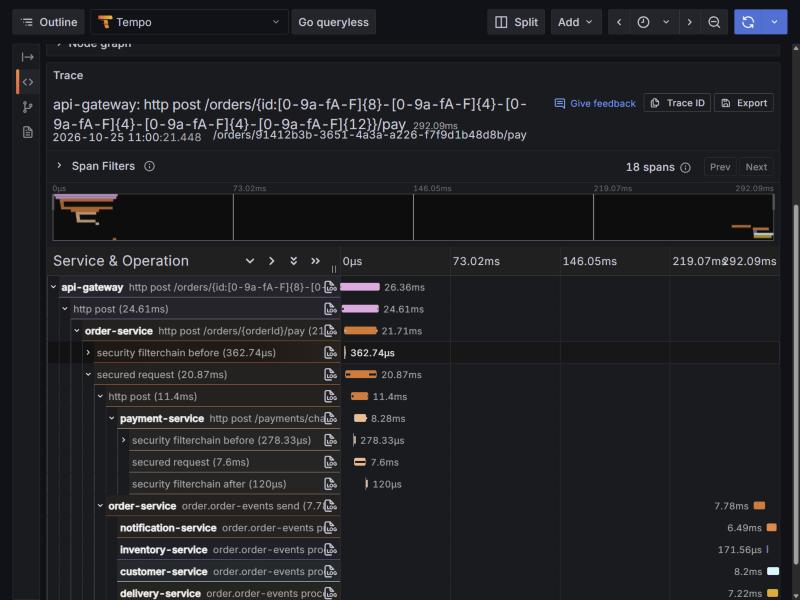
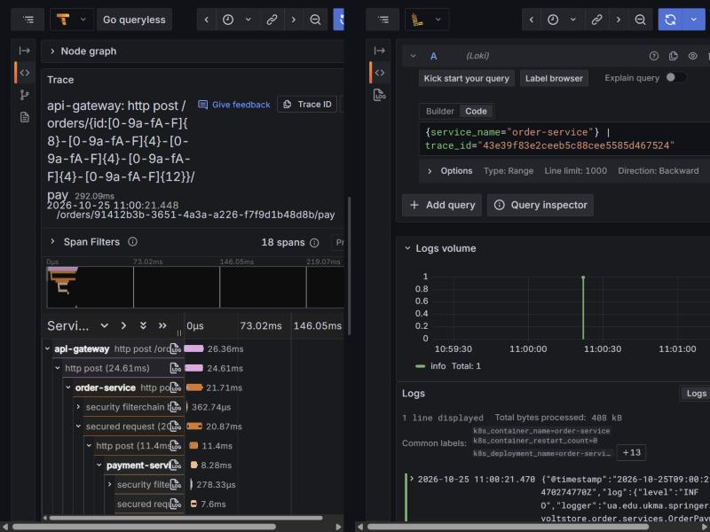
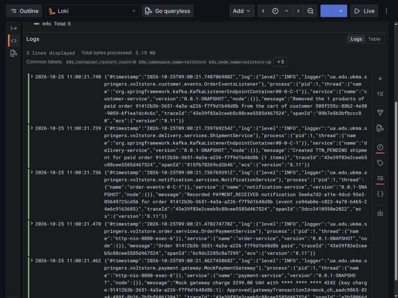
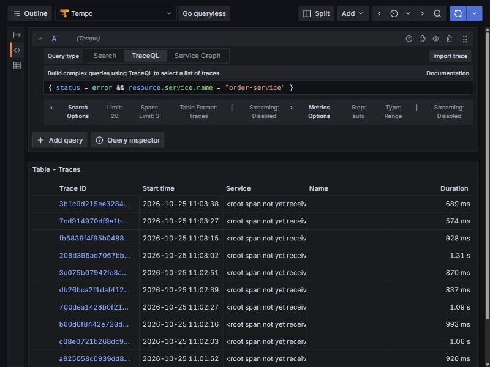
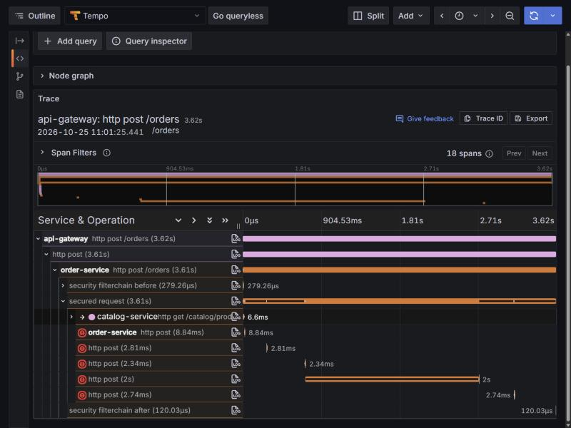
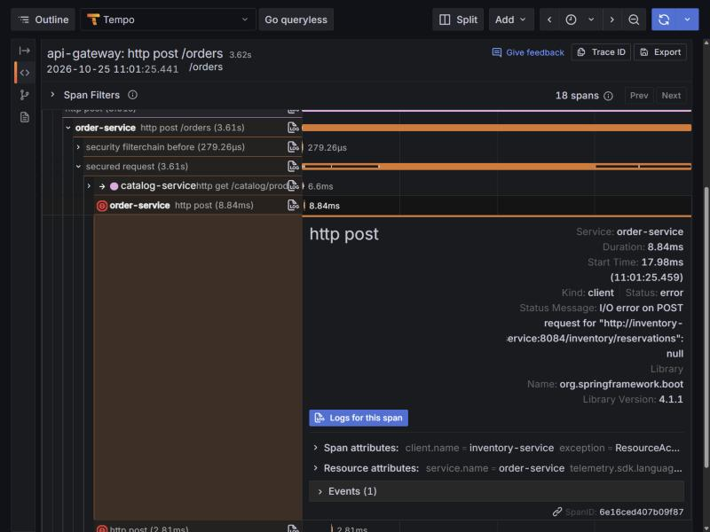
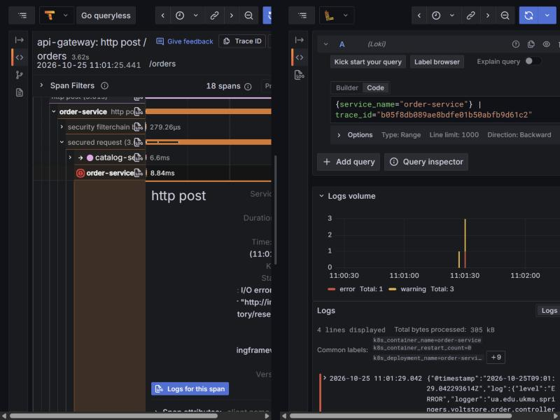
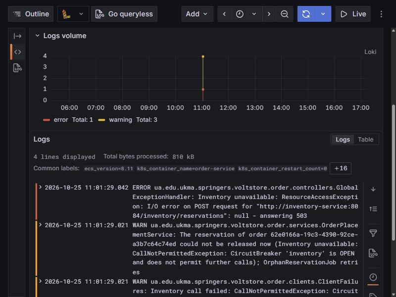
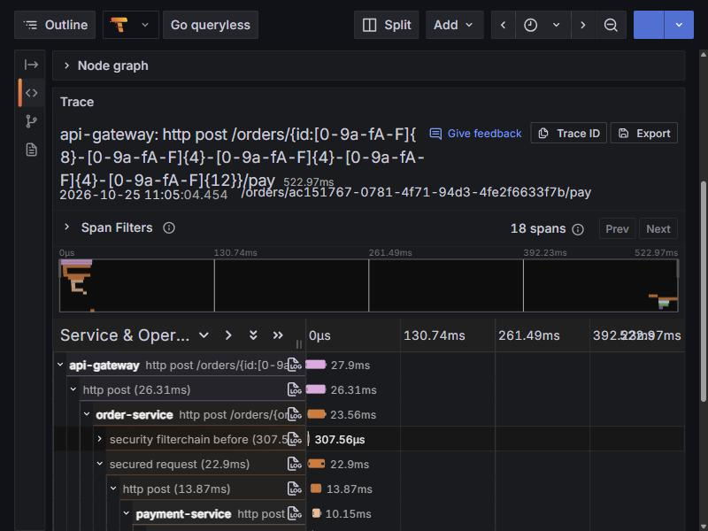

# Distributed Tracing and Centralized Logs: Setup and Investigation

Group assignment: *OpenTelemetry Collector, Grafana Tempo and Grafana Loki in Kubernetes; W3C Trace Context through HTTP calls and Kafka messages; tail sampling that keeps every trace with an error; one end-to-end trace across at least three services and a Kafka topic; JSON logs with a shared `traceId`; one click from a span to its logs; an incident investigated with these tools.* Runs: 2026-10-24 and 2026-10-25 on minikube (profile `voltstore-np`, one node). Tasks: [docs/tasks/infrastructure/observability/](../tasks/infrastructure/observability/00-overview.md).

## 1. Architecture

```
 browser ─► api-gateway ──HTTP + traceparent──► order ──HTTP + traceparent──► catalog, inventory, payment, delivery
                                                  │
                                                  └─ outbox row (+ traceparent column) ─► relay ─► Kafka record (traceparent header)
                                                                                                    │
                                                  inventory, delivery, customer, notification ◄─────┘ listeners continue the trace

 every service ──OTLP/HTTP spans──► otel-collector (Deployment, 1 replica: tail sampling) ──OTLP gRPC──► Tempo ◄──┐
 every pod's stdout (ECS JSON) ──► /var/log/pods ──► otel-agent (DaemonSet: filelog) ──OTLP/HTTP──────► Loki  ◄──┴── Grafana
                                                                                                                   span ⇄ logs
```

| What | Where |
|---|---|
| Collector (gateway): OTLP in, tail sampling, export to Tempo | [`otel-collector-config.yaml`](../../k8s/observability/otel-collector-config.yaml), [`otel-collector-deployment.yaml`](../../k8s/observability/otel-collector-deployment.yaml) |
| Collector (agent): pod log files → Loki | [`otel-agent-config.yaml`](../../k8s/observability/otel-agent-config.yaml), [`otel-agent-daemonset.yaml`](../../k8s/observability/otel-agent-daemonset.yaml) |
| Tempo 2.8.1 (monolithic, 48 h) / Loki 3.5.3 (single binary, 48 h) | [`tempo-*.yaml`](../../k8s/observability/tempo-config.yaml), [`loki-*.yaml`](../../k8s/observability/loki-config.yaml) |
| Grafana 12.1.0, data sources and their links provisioned from a ConfigMap | [`grafana-datasources.yaml`](../../k8s/observability/grafana-datasources.yaml), [`grafana-deployment.yaml`](../../k8s/observability/grafana-deployment.yaml) |
| Tracing in the services: starter, sampling, propagation, exporter endpoint | each `*/pom.xml`, `*/src/main/resources/application.yml`, `k8s/<service>/app-config.yaml` |
| Who may talk to whom (only the collectors reach Tempo and Loki) | [`k8s/network/network-policies.yaml`](../../k8s/network/network-policies.yaml) |

### Decisions and their trade-offs

| Decision | Why | Cost |
|---|---|---|
| **Two collectors**: an agent DaemonSet for logs, a gateway Deployment of exactly one replica for spans | Log files are local to a node (one reader per node); tail sampling must see every span of a trace in one process | The gateway is a single point of failure for spans; scaling it needs a `loadbalancing` exporter by trace id in front of several samplers |
| **Logs via stdout + file tailing**, not a Logback OTLP appender | No logging library in the services; lines wait in the file while the collector or Loki is down; startup crashes and non-Java pods are collected too; `kubectl logs` shows exactly what Loki stores | Lines are lost if the agent is down longer than the kubelet keeps rotated files |
| **Correlation id removed**, the trace id replaces it | The old id was a placeholder (never set by the gateway, missing in three services, not crossing Kafka, in no log pattern); two ids per request would contradict "consistent `traceId`" | None found |
| **ECS JSON logs, always on** (`logging.structured.format.console: ecs`) | A documented schema with `service.name`, `log.level` and `error.*` (stack trace in the same line); tests, IDE, Compose and Kubernetes print the same lines | A less readable console when developing locally |
| **100 % sampling in the services, tail sampling in the collector** | Head sampling would drop traces before anyone knows they contain an error | Every span crosses the network to the collector |
| **Tail-sampling policies**: errors, slow > 1 s, 25 % baseline; `decision_wait` 10 s | Every error trace is kept; 1 s is the `HighHttpLatency` alert threshold; 25 % keeps normal traffic visible but visibly drops some | A 4xx (402 declined card, 409 stock) is not an error by the OpenTelemetry HTTP conventions and is kept only by the baseline |
| **`traceparent` stored in an outbox column**; the relay's producer span is a child of the request | The relay publishes later, from a scheduled job where the request's context is gone; one tree was required | The commit → publish gap shows as idle time inside the trace |

## 2. Collector Configuration, Block by Block

### 2.1 Gateway collector (spans)

```yaml
receivers:
  otlp:                       # the services send OTLP/HTTP to :4318; gRPC :4317 is open too
    protocols:
      grpc: { endpoint: 0.0.0.0:4317 }
      http: { endpoint: 0.0.0.0:4318 }

processors:
  memory_limiter:             # first: refuses data before the process runs out of memory
    check_interval: 1s
    limit_percentage: 80
    spike_limit_percentage: 25
  tail_sampling:              # decides per complete trace
    decision_wait: 10s        # > the longest gap in a trace: relay poll 500 ms + Kafka + consumer + retries
    num_traces: 50000
    policies:                 # a trace is kept if ANY policy keeps it
      - name: errors          # mandatory: every trace with an ERROR span
        type: status_code
        status_code: { status_codes: [ ERROR ] }
      - name: slow            # same threshold as the HighHttpLatency alert
        type: latency
        latency: { threshold_ms: 1000 }
      - name: baseline        # a share of everything else; one value in ConfigMap otel-collector-sampling
        type: probabilistic
        probabilistic: { sampling_percentage: ${env:BASELINE_SAMPLING_PERCENTAGE} }
  batch: { }                  # last: fewer, larger exports, and only of kept traces

exporters:
  otlp/tempo:
    endpoint: tempo:4317
    tls: { insecure: true }   # plain gRPC inside the namespace

service:
  pipelines:
    traces:
      receivers: [ otlp ]
      processors: [ memory_limiter, tail_sampling, batch ]   # order matters
      exporters: [ otlp/tempo ]
  telemetry:                  # the collector's own metrics on :8888, scraped by Prometheus
```

Changing the baseline means editing one value (`BASELINE_SAMPLING_PERCENTAGE` in `otel-collector-sampling`) and restarting the collector. The pipeline stays as it is.

### 2.2 Agent collector (logs)

| Block | Job |
|---|---|
| `filelog` receiver | Tails `/var/log/pods/voltstore_*/*/*.log` (its own pod excluded), from the end at the very first start; offsets in `file_storage` on the node, so a restarted agent neither skips nor repeats lines |
| `container` operator | Unwraps the container runtime's format and sets `k8s.namespace.name`, `k8s.pod.name`, `k8s.container.name` from the path |
| `json_parser` (only lines starting with `{"@timestamp"`) | Parses the ECS line into a temporary attribute and sets the record's timestamp and severity; Kafka and PostgreSQL text passes through |
| `trace_parser` (only if `traceId` exists) | Sets the record's trace id and span id |
| `remove` | Drops the temporary attribute; **the body stays the original JSON line**, so `| json` works in Loki |
| `k8sattributes` processor | Adds pod metadata from the API (namespaced Role); `service.name` from the pod label `app` |
| `otlphttp/loki` exporter | Loki's native OTLP endpoint |

Loki indexes only `service.name`, `k8s.namespace.name` and `k8s.pod.name` as labels (`otlp_config` in `loki-config.yaml`). Everything else, including `trace_id`, `span_id` and the severity, is structured metadata. **A trace id is never a label:** every value would open a new stream, and millions of streams make Loki slow and expensive. This is the same reason the Prometheus metrics have no order ids as labels.

### 2.3 Sampling, measured

| Run | Kept in Tempo |
|---|---|
| 40 successful `GET /catalog/products` | 7 (17.5 %; at 25 % about 10 ± 3 are expected) |
| 10 requests with catalog scaled to 0 (502) | 10 of 10 |
| Incident: 12 checkouts with inventory scaled to 0 (503) | 12 of 12 |

The collector's counters, as Prometheus scraped them (2026-10-25, all traffic since the collector started):

| Policy | Kept | Not matched |
|---|---|---|
| `baseline` | 126 | 486 |
| `errors` | 10 | 602 |
| `slow` | 5 | 607 |

The query in Prometheus is `sum by (policy, sampled) ({"otelcol_processor_tail_sampling_count_traces_sampled_{traces}_total"})`. The name needs the quoted form because the collector exports UTF-8 names with the unit in braces.

## 3. How the W3C Trace Context Travels

**The header.** `traceparent: 00-<trace id>-<parent span id>-<flags>`. A real value, from the outbox row of the scenario's `OrderPaid` event:

```
00-43e39f83e2ceeb5c88cee5585d467524-6c9dc2285c8a7299-01
│  │                                │                └─ flags: 01 = sampled (the OpenTelemetry SDK's own HTTP calls send 03 = sampled + random trace id)
│  │                                └─ parent span id (16 hex): Order's span that wrote the event; Order's log line "Order … paid" carries the same spanId
│  └─ trace id (32 hex): the whole request, every service, both sides of Kafka
└─ version 00
```

1. **HTTP.** Every service has `spring-boot-starter-opentelemetry` (Micrometer Tracing with the OpenTelemetry bridge and the OTLP exporter):
   - `management.tracing.sampling.probability: 1.0` and `propagation.type: w3c`;
   - the exporter endpoint comes from the Kubernetes ConfigMap (`MANAGEMENT_OPENTELEMETRY_TRACING_EXPORT_OTLP_ENDPOINT`), so Compose and the tests export nothing.
   - Server requests are observed automatically. The `RestClient`s are built with `.observationRegistry(...)`, so every call is a client span and sends `traceparent`.
   - The gateway's proxy client was already instrumented: it continues an incoming `traceparent` or starts a new trace.
   - Probes, scrapes (`/actuator/**`, an `ObservationPredicate`) and `@Scheduled` runs make no traces.
2. **The outbox.** Order, Inventory, Delivery and Catalog publish events through a transactional outbox, and a scheduled relay sends them later, when the request's context is gone. So:
   - `OutboxTraceContext.current()` stores the current `traceparent` in a new nullable column, `outbox_events.traceparent`, in the same transaction as the business change;
   - the relay makes that context current again (`restore`) around `KafkaTemplate.send`.
3. **Kafka.** The relay's template has observation on, so it creates a producer span as a child of the stored context and writes the record's `traceparent` header itself. Every listener container has observation on (`spring.kafka.listener.observation-enabled: true`), so each consumer group's span continues from that header. One event therefore becomes one producer span with a branch per consumer group. Dead-letter records keep the original header: the recoverers copy headers, and their templates are not observed.

Tests:
- `TracePropagationTest` per calling service, plus the gateway: a WireMock request carries `00-<current trace id>-…`.
- Order `OutboxIntegrationTest`: a stored and published event stays in the request's trace, under a new producer span.
- Inventory `ConsumedEventsIntegrationTest`: a consumed event is handled in the trace of its header, and a dead-lettered event keeps its `traceparent`.

## 4. JSON Logs with a Shared `traceId`

Two lines of the scenario's pay request, from two services, as stored in Loki (and as `kubectl logs` shows them):

```json
{"@timestamp":"2026-10-25T09:00:21.470274770Z","log":{"level":"INFO","logger":"ua.edu.ukma.springers.voltstore.order.services.OrderPaymentService"},"process":{"pid":1,"thread":{"name":"http-nio-8080-exec-6"}},"service":{"name":"order-service","version":"0.0.1-SNAPSHOT","node":{}},"message":"Order 91412b3b-3651-4a3a-a226-f7f9d1b48d8b paid","traceId":"43e39f83e2ceeb5c88cee5585d467524","spanId":"6c9dc2285c8a7299","ecs":{"version":"8.11"}}
{"@timestamp":"2026-10-25T09:00:21.739769254Z","log":{"level":"INFO","logger":"ua.edu.ukma.springers.voltstore.delivery.services.ShipmentService"},"process":{"pid":1,"thread":{"name":"org.springframework.kafka.KafkaListenerEndpointContainer#0-0-C-1"}},"service":{"name":"delivery-service","version":"0.0.1-SNAPSHOT","node":{}},"message":"Created TTN_PENDING shipment for paid order 91412b3b-3651-4a3a-a226-f7f9d1b48d8b (1 items)","traceId":"43e39f83e2ceeb5c88cee5585d467524","spanId":"815fb78269cd2b46","ecs":{"version":"8.11"}}
```

The same trace id, written 270 ms apart: once in an HTTP thread of Order, once in a Kafka listener thread of Delivery. Lines logged outside a trace (startup, jobs) are the same JSON without `traceId` and `spanId`. The log statements were checked for secrets: they name headers and log ids only, and Payment masks the card (`**** **** **** 4242`).

Two ways to query one request in Loki:
- `{service_name="order-service"} | json | traceId="<id>"` parses every line;
- `{k8s_namespace_name="voltstore"} | trace_id="<id>"` uses the structured metadata: no parsing, all services. Grafana's span → logs link uses this one.

## 5. End-to-End Trace and the Diagnostic Loop

### 5.1 The scenario

[`tracing-logging/e2e-trace.sh`](tracing-logging/e2e-trace.sh) runs as the seed customer:
1. signs in;
2. places an order for an in-stock product;
3. pays it with the test card `4242…`, through the gateway, the same two requests the checkout page makes.

Each request carries its own `traceparent`, so the trace id is known before Tempo has it. Successful traces are kept at 25 %, so the script repeats until Tempo has the pay trace; this time that took **three runs**.

Placing and paying are two HTTP requests, so they make two traces: stock is reserved in the place trace. The pay trace `43e39f83e2ceeb5c88cee5585d467524` covers the gateway, Order, Payment, the Kafka producer and four consumer services (inventory among them):



*Logs for this span* on Order's span opens Loki next to the trace, with the query Grafana generated from the span (`{service_name="order-service"} | trace_id="43e39f…"`):



The same trace id across all services: five JSON lines from Customer, Delivery, Notification, Order and Payment:



In the other direction, Loki's derived field on `trace_id` adds an "Open trace in Tempo" link to every line that has a trace. It is provisioned and its stored configuration was checked through the Grafana API, but it was not clicked during this run.

### 5.2 The incident: a dependency is down

**Why this incident:** it needs no code change, it is what an outage looks like in production, and it exercises every step of the loop. It triggers:
- an alert and an error the user sees;
- error spans that the tail sampler keeps;
- retries and a circuit breaker, visible as repeated client spans;
- error logs.

```bash
kubectl -n voltstore scale deploy/inventory-service --replicas=0    # 09:01 UTC
# 12 checkouts, one every 10 s → all answer 503
```

1. **Symptom.** Checkout answers `503`, with `"detail":"The order cannot be processed right now because a required service is unavailable. Please try again later."`. In Prometheus, `ServiceMissing inventory-service` is **firing**, and `HighHttpErrorRate` and `HighHttpLatency` are pending for `api-gateway` and `order-service`.
2. **The error trace, kept by tail sampling.** TraceQL `{ status = error && resource.service.name = "order-service" }` lists the incident's traces. All 12 were kept, while successful traces needed several runs to get one kept:

   

3. **The failing span.** Trace `b05f8db089ae8bdfe01b50abfb9d61c2` took 3.6 s. Order's calls to inventory are red:
   - three `POST /inventory/reservations` attempts (Resilience4j retries, then the circuit breaker opens);
   - then the calls releasing the reservation (the 2 s one is the client timeout).

   

   The span's attributes say what failed: client `inventory-service`, status `error`, *I/O error on POST request for "http://inventory-service:8084/inventory/reservations"*, exception `ResourceAccessException`.

   

4. **The span's logs.** *Logs for this span* (1 error, 3 warnings):

   

   The lines, full width: `ERROR … GlobalExceptionHandler: Inventory unavailable: ResourceAccessException … answering 503`, then the warnings that the circuit breaker `inventory` is OPEN and that the reservation release is left to `OrphanReservationJob`:

   

5. **Cause.** The trace names the failing dependency and the logs name the error, both pointing at Inventory, which has no pod: `kubectl -n voltstore get deploy inventory-service` → `0/0`.
6. **Fix.** `kubectl -n voltstore scale deploy/inventory-service --replicas=1`.
7. **Confirmation.** The next scenario run succeeded, and its pay trace `d0f2e5c39159e005b66d64e8439c4179` has no error spans:

   

Two observations from the incident:
- Gateway and Order answered 503, but their **server** spans are not marked error. Micrometer marks a server span as error only on an exception, and the 503 is a handled answer. The failing **client** spans are errors, and the tail sampler needs only one error span to keep a trace.
- "Root span not yet received" in the trace list: the script sends its own `traceparent`, so the true root is the script's span, which is never exported.

## 6. Limitations and What Production Would Change

| Here | In production |
|---|---|
| One tail-sampling collector: a single point of failure, and it cannot scale out | A `loadbalancing` exporter that routes by trace id in front of several sampler replicas |
| Tempo, Loki and Grafana keep data in `emptyDir` (48 h retention): a pod deletion loses traces and logs | Object storage (S3/GCS) for Tempo and Loki, a database for Grafana |
| Baseline sampling 25 %, so the demo trace is kept after a few runs | 1–10 %; the error and latency policies still keep every interesting trace |
| One-node minikube with 10 GiB: restarting all nine JVMs at once once exhausted the node's original 6 GiB and stopped the API server | Real nodes, and a rollout strategy that never restarts every service at once |
| Grafana is reached by `kubectl port-forward`, with a local admin account | Single sign-on, behind the Ingress |
| The JVM's own startup warnings (stderr, before logging starts) are not JSON | Silence the `sun.misc.Unsafe` warnings (`--sun-misc-unsafe-memory-access=allow`, or a newer protobuf); keep the `JAVA_TOOL_OPTIONS` notice as plain text |
| Logs can be lost if the agent is down longer than the kubelet keeps rotated files | Larger log rotation limits, or a persistent buffer in the agent |
| The 4xx answers (402 declined card) are kept only by the baseline | A policy on a business attribute, if declined payments must always be traceable |

## 7. Repeating It in Minikube

```bash
# Stack (with the services' images built and loaded), then the observability components and policies
kubectl apply -f k8s/observability/ -f k8s/network/network-policies.yaml
kubectl port-forward -n voltstore svc/api-gateway 18081:8080 &
kubectl port-forward -n voltstore svc/tempo 13200:3200 &
kubectl port-forward -n voltstore svc/grafana 3000:3000 &   # sign in with the grafana-admin Secret

sh docs/reports/tracing-logging/e2e-trace.sh                  # prints the kept pay trace id
# Incident: scale inventory-service to 0, run the script (it stops at the 503 of placing the order), find the error
# trace with TraceQL { status = error }, then scale back to 1 and run the script again
```

The submission archive is built from committed files only and refuses any `secret.yaml` or `.env`:

```bash
sh docs/reports/tracing-logging/build-archive.sh
```
